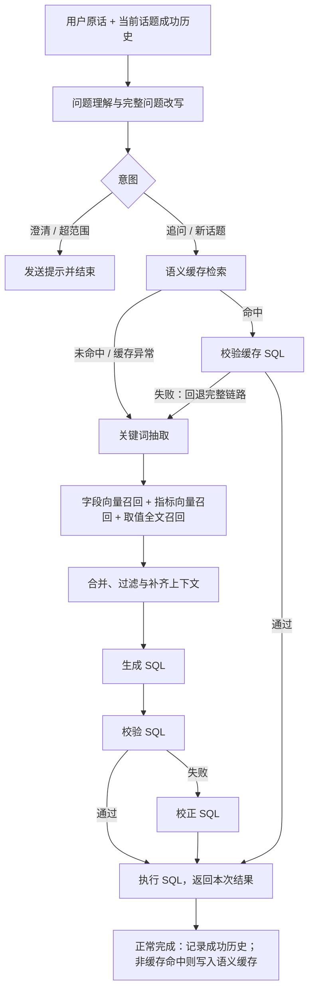

# 电商智能问数 Agent

> 基于 LangGraph 的自然语言数据分析工作流，支持多轮追问、语义缓存与 SQL 执行闭环。

将“统计 2025 年华北地区的销售额，按品牌分组”这样的业务问题，转换为数据库查询并返回结果。用户可以继续问“那华东呢？”或“改成按月份分组”；对于能够匹配成功 SQL 的高频问题，系统通过语义缓存复用查询逻辑，跳过重复的检索与生成步骤。

项目基于开源电商 NL2SQL 工程扩展，重点围绕 **对话上下文管理、LangGraph 条件路由、成功 SQL 复用和失败回退** 展开。原有字段、指标、取值检索及 SQL 主链路继续复用，新增能力接入同一套 FastAPI / SSE 查询接口。

[核心扩展](#核心扩展) · [工作流](#工作流) · [本地运行](#本地运行) · [验证与测试](#验证与测试) · [代码导航](#代码导航)

## 核心扩展

### 多轮问数：让追问保留业务条件

在查询入口引入结构化问题理解，将本轮原话与当前话题的成功历史转成完整问题，再交给原有 NL2SQL 链路。

| 对话输入 | 处理目标 |
| --- | --- |
| 统计 2025 年华北地区的销售总额，按品牌分组 | 建立年份、地区、指标与分组条件 |
| 那华东呢？ | 替换地区，继承年份、指标与分组 |
| 改成按月份分组 | 调整分组，保留当前统计条件 |
| 只看第一季度 | 追加时间范围限制 |
| 换个问题，统计商品总数 | 切换话题，避免继续继承旧销售条件 |

设计要点：

- **结构化意图路由**：区分追问、新话题、需要澄清和超范围问题，信息不足时直接回复。
- **成功历史管理**：按 `session_id` 记录原话、完整问题与 SQL，仅在本轮查询正常结束且执行成功时追加。
- **话题边界与执行结果分离**：识别到新话题即移动历史起点，避免新查询失败后又继承更早的话题。
- **前后端会话衔接**：服务端通过 SSE 返回会话编号，前端在后续请求中复用。

实现与验证记录见 [多轮问数与会话记忆](docs/改造记录-多轮问数与会话记忆.md)。表中对话用于说明处理目标，不预设查询结果。

### 语义缓存：复用成功 SQL，缩短重复问数路径

复用现有 **bge-large-zh-v1.5 Embedding 与 Qdrant**，独立维护 `chatbi_semantic_cache` 集合，保存完整问题向量与已执行成功的 SQL。

| 环节 | 实现方式 |
| --- | --- |
| 缓存匹配 | 使用改写后的完整问题检索，Cosine 相似度默认阈值 `0.95`，取最高分记录 |
| 命中路径 | 跳过关键词抽取、三路召回、上下文处理与 SQL 生成，直接校验并执行缓存 SQL |
| 未命中路径 | 沿用完整 NL2SQL 工作流，执行成功后异步写入缓存 |
| 失效 SQL 回退 | 缓存 SQL 校验失败时，回到完整检索链路重新准备上下文并生成 SQL |
| 异常降级 | 缓存读取异常按未命中处理；写入异常记录日志，保留成功查询结果 |
| 可观测性 | SSE 输出 `cache_hit`、`cache_fallback` 进度，日志记录命中 ID 与相似度 |

缓存复用的是 **SQL**；命中后仍重新查询数据库。它减少后续检索与生成工作，保留最前面的意图理解，以及数据库校验和执行。当前阈值为默认策略，实际命中率、误命中率及性能收益尚未评测。

技术说明与测试范围见 [语义缓存设计](docs/语义缓存设计.md)。

## 工作流



FastAPI 通过 SSE 持续返回会话编号、节点进度、查询结果或错误。缓存检查接在问题改写之后，让省略式追问先补全条件，再参与 SQL 复用。

## 技术栈

| 层次 | 技术与职责 |
| --- | --- |
| 智能体工作流 | LangGraph：状态传递、并行召回与条件分支 |
| 模型调用 | LangChain：提示词、结构化解析与模型客户端 |
| 后端接口 | FastAPI、SSE：查询入口与流式反馈 |
| 数据访问 | MySQL、SQLAlchemy：业务数仓与结构化元数据 |
| 检索与缓存 | Qdrant：字段/指标向量检索及语义缓存；Elasticsearch：字段取值全文检索 |
| 向量化服务 | TEI、BAAI/bge-large-zh-v1.5，向量维度沿用现有 `1024` 维配置 |
| 前端 | React、TypeScript、Vite、Tailwind CSS |
| 工程工具 | uv、pnpm、Docker Compose、Ruff、unittest |

## 本地运行

需要 Python 3.14+、uv、Docker Compose、Node.js 和 pnpm。以下使用 PowerShell，默认模型配置位于 `conf/app_config.yaml`，可按所用服务调整模型名与接口地址。

### 1. 获取源码与配置模型

```powershell
git clone --branch main https://github.com/minimaod/-agent.git ecommerce-query-agent
cd ecommerce-query-agent
uv sync
Copy-Item .env.example .env
```

在 `.env` 中配置 `LLM_API_KEY`。当前示例配置使用 `deepseek-flash` 与 `https://api.deepseek.com`；真实密钥不提交到仓库。

### 2. 启动基础服务并构建知识库

首次运行需下载 Embedding 模型，权重不包含在仓库中。

```powershell
uv run hf download BAAI/bge-large-zh-v1.5 --local-dir docker/embedding/bge-large-zh-v1.5
docker compose -f docker/docker-compose.yaml up -d
```

待 MySQL、Elasticsearch、Qdrant 与 Embedding 就绪后，首次使用时构建元数据知识库：

```powershell
uv run python -m app.scripts.build_meta_knowledge -c conf/meta_config.yaml
```

MySQL 初始化脚本仅在空数据目录首次启动时执行。语义缓存集合在首次访问时自动创建，无需额外构建脚本。

### 3. 启动后端

```powershell
uv run uvicorn main:app --host 127.0.0.1 --port 8000
```

打开 [接口文档](http://127.0.0.1:8000/docs)。查询接口为 `POST /api/query`：

```json
{
  "query": "统计2025年华北地区的销售总额，按品牌分组",
  "session_id": "demo-session-001"
}
```

省略 `session_id` 时，服务端生成编号并通过 `session` SSE 事件返回；后续追问携带同一编号。

### 4. 启动前端

另开终端进入项目的 `frontend` 目录：

```powershell
cd frontend
pnpm install
pnpm dev
```

前端通过 Vite 代理访问本地 `8000` 端口的后端。“新会话”和“清空”会清除页面保存的会话编号，下一次请求创建新会话。

## 验证与测试

| 范围 | 当前验证 |
| --- | --- |
| 多轮问数 | 已完成指定页面场景联调，覆盖条件继承、替换、追加、分组调整、新话题和新会话澄清；失败处理通过模拟验证 |
| 语义缓存 | **15 项离线自动化测试通过**，覆盖存取、阈值、路由、异常降级、失效回退及两轮请求的缓存闭环 |

缓存测试使用本地内存 Qdrant、人工向量与模拟模型/数据库依赖，不需要启动 Docker 或真实模型服务。运行前需完成依赖安装和 `.env` 配置加载：

```powershell
uv run python -m unittest discover -s tests -v
```

缓存的真实 Embedding / Qdrant / MySQL 联调、语义匹配评估及性能对比待补充。离线测试验证程序行为，不代表真实模型准确率或生产环境性能。

## 代码导航

| 入口 | 关注点 |
| --- | --- |
| [graph.py](app/agent/graph.py) | 意图、缓存命中及 SQL 校验后的条件路由 |
| [state.py](app/agent/state.py) / [context.py](app/agent/context.py) | 本轮业务状态与外部服务依赖的分工 |
| [rewrite_query.py](app/agent/nodes/rewrite_query.py) | 历史格式化与结构化问题改写 |
| [check_semantic_cache.py](app/agent/nodes/check_semantic_cache.py) | 缓存查询、命中状态与进度事件 |
| [semantic_cache_service.py](app/services/semantic_cache_service.py) | 独立集合管理、Embedding、缓存检索与写入 |
| [validate_sql.py](app/agent/nodes/validate_sql.py) | 数据库校验与失效缓存回退 |
| [query_service.py](app/services/query_service.py) | SSE 输出、成功历史与缓存写入条件 |
| [conversation_memory.py](app/services/conversation_memory.py) | 成功记录和当前话题边界 |
| [dependencies.py](app/api/dependencies.py) | 请求依赖组装与客户端复用 |
| [test_semantic_cache.py](tests/test_semantic_cache.py) | 缓存服务和工作流的离线测试 |
| [App.tsx](frontend/src/App.tsx) | 会话编号复用与流式事件消费 |

## 后续迭代

- **缓存匹配治理**：增加关键筛选条件核对、有效期及元数据版本约束，评估时间表达变化和相近问题的误命中。
- **会话存储**：为进程内历史补充持久化、容量控制和同会话并发管理。
- **权限边界**：会话编号目前只关联历史；用户认证、租户隔离及缓存权限过滤尚未接入。
- **交互与结果引用**：完善前端缓存分支展示；当前未保存历史结果行，不支持“刚才排名第一的商品”等结果引用。

## 开源来源与许可

基础工程来自 [didilili/shopkeeper-agent](https://github.com/didilili/shopkeeper-agent)。字段、指标、取值检索，原有 SQL 生成执行链路及前后端基础工程沿用上游；本仓库在此基础上扩展多轮问数、话题边界、语义缓存与相关测试。

保留原项目 MIT 许可证，详见 [LICENSE](LICENSE)。
